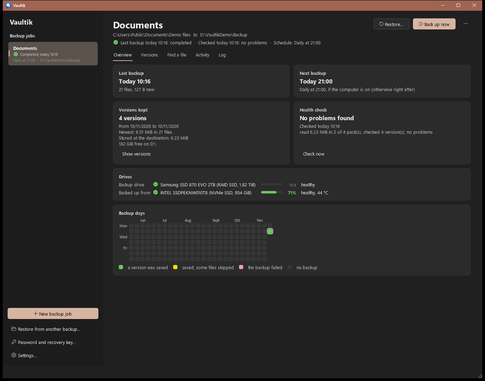
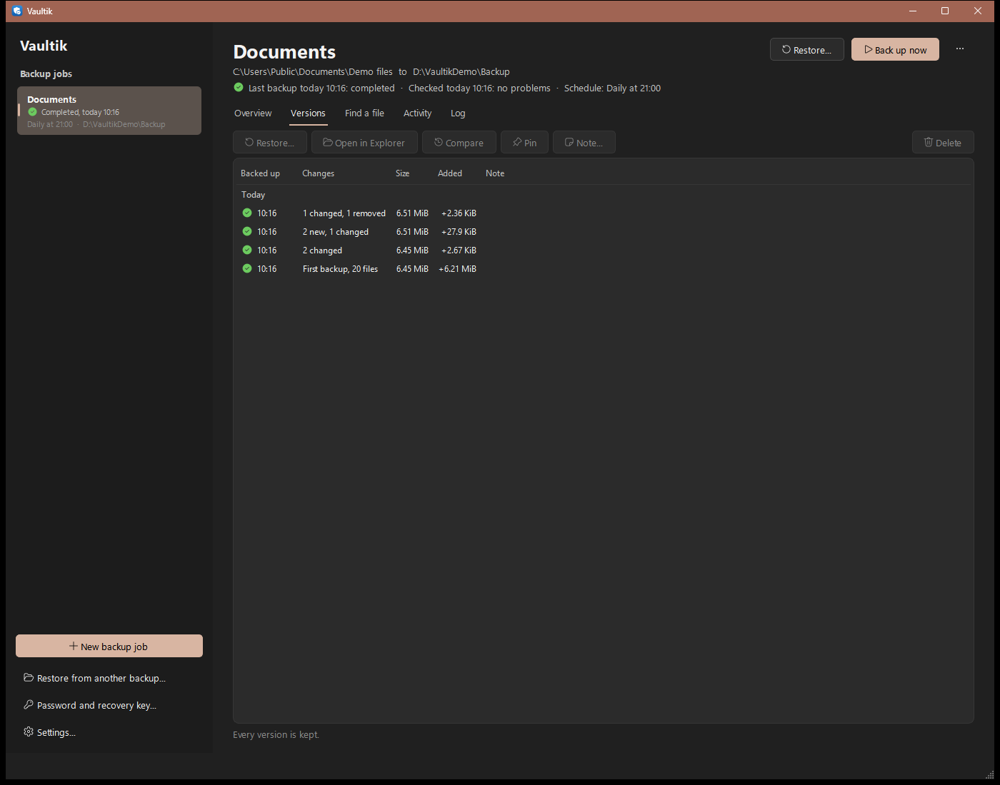
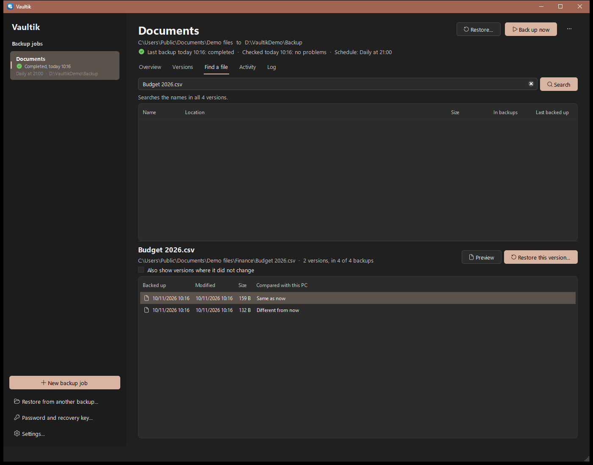
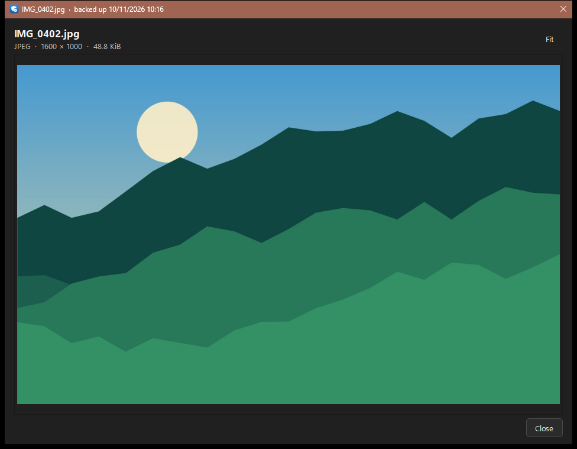
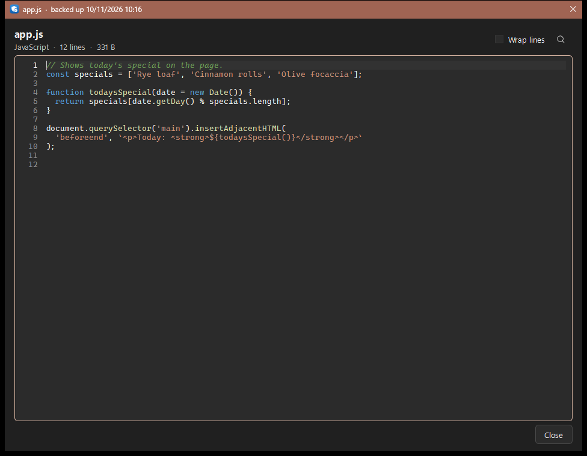
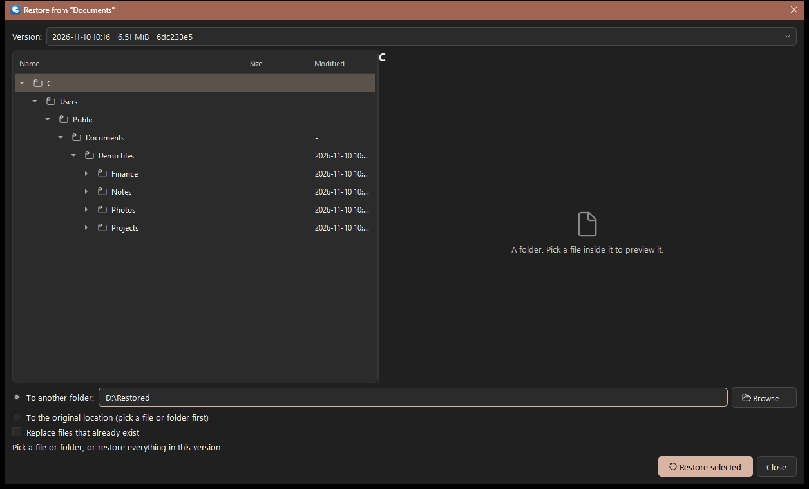
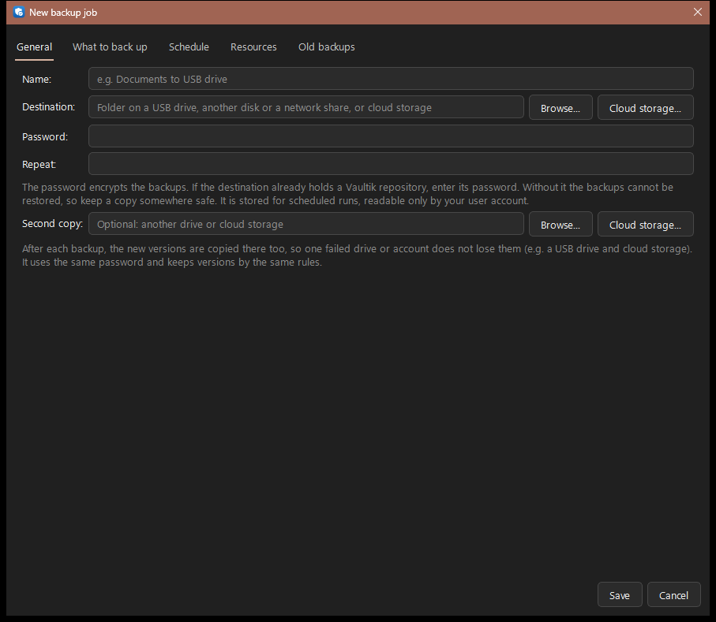
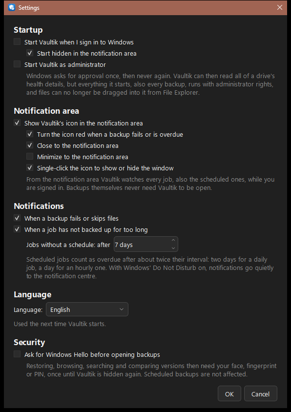

# Vaultik

Lightweight, deduplicating, compressed and encrypted backups for Windows, written in C++20, with a
Qt 6 frontend. Linux support is planned: the platform code is written but not yet built or tested.

- **Small and idle-free.** The engine is one static ~1 MB executable: no service, no kernel driver.
  Scheduled backups are started by the system scheduler, run, and exit. Peak RAM stays around
  100 MB however much data there is (measured: 101 MB for a 9.7 GB folder with the worker threads,
  9 MB for an unchanged re-run; packs written in the background add 32 MiB each, and the
  4 parallel file readers about 45 MB more). The frontend only uses memory while it is open.
- **Deduplicated.** Files are split into content-defined chunks (FastCDC, ~1 MiB average). A chunk
  already stored, from any file in any earlier snapshot, is never stored again. Every snapshot looks
  like a full backup but only adds what changed.
- **Compressed and encrypted.** Each chunk is zstd-compressed, then sealed with AES-256-GCM. Chunk
  ids are keyed BLAKE3 hashes, so the storage location learns nothing about the content.
- **Fast incremental runs.** Files whose size and timestamps match the previous snapshot are not
  even read.
- **Polite.** Priorities and hard limits for CPU, disk, memory and bandwidth, per job.
- **Verifiable.** `verify --read-data` decrypts and checks every stored chunk, and jobs run
  health checks on their own (see below).
- **Portable repositories.** A repository written on Windows restores on Linux and the other way
  round (same format, same crypto).
- **Local or cloud.** Back up to a disk, a USB drive, a network share, S3-compatible cloud
  storage (Cloudflare R2, Backblaze B2, Amazon S3, IDrive e2, MinIO, ...), or a cloud drive
  (pCloud, OneDrive, Google Drive, MEGA), a WebDAV server (Nextcloud, ownCloud, a NAS), or an SSH
  server over SFTP, each through its own API with no extra software. The cloud only ever sees
  encrypted chunks.
- **Watches the drives.** The health of the backup drive and the drives backed up from, with a
  percentage from S.M.A.R.T. and a warning when a drive gets worse.
- **Easy to get files back.** A timeline of versions, a search across all of them, the history
  of any file, a preview of pictures and code without restoring, and each version as a folder in
  File Explorer.
- **Several PCs in one view.** Computers that back up into the same place (a shared folder, a
  NAS, a cloud bucket) leave an encrypted status note there, so any of them shows how every
  computer's backups are doing.

The on-disk format is specified in [docs/FORMAT.md](docs/FORMAT.md).

## Screenshots

The overview of a job: its last and next backup, the versions kept, the last health check, the
drives involved with their health, and the days a backup ran.



| | |
|---|---|
|  The versions, each with what changed |  A file's versions, compared with the file on this PC |
|  A picture from a backup, without restoring it |  Text and code with syntax colours |
|  Restore a file, a folder or everything |  A new backup job |
|  Settings | |

## Programs

| Program | What it is |
|---|---|
| `vaultik-gui` | The frontend: backup jobs, schedules, progress, history, snapshot browser, restore |
| `vaultik` | The engine and command line. The frontend and the scheduler run it for the actual work |
| `vaultik-task` | Windows only: windowless launcher that Task Scheduler starts, so no console flashes up |

## Build

**Windows:** Visual Studio 2022 or later with the C++ workload (MSVC, CMake and the bundled vcpkg).

```
build.cmd release test
```

The programs end up in `build\release\`. Dependencies (zstd, BLAKE3, nlohmann-json, Qt 6 for the
frontend, doctest for tests) come from vcpkg and are linked statically. The first build compiles
a minimal Qt and takes a while; later builds reuse it.

**Linux (planned, not yet built or tested):** a C++20 compiler (GCC 12+ or Clang 16+), CMake,
Ninja, vcpkg, OpenSSL and Qt 6 development packages. On Debian or Ubuntu:

```
sudo apt install build-essential cmake ninja-build pkg-config libssl-dev qt6-base-dev
export VCPKG_ROOT=~/vcpkg   # a vcpkg checkout
./build.sh release test
```

The frontend uses the system Qt on Linux. Configure with `-DVAULTIK_BUILD_GUI=OFF` for a
command-line-only build (servers). Until the Linux port is verified, the Linux notes in this
README describe the intended behavior.

## Using the frontend

Start `vaultik-gui`, then **New backup job**:

- **General:** a name, the destination (a folder on a USB drive, other disk or network share, or
  **Cloud storage...**) and the repository password. A new destination gets a new encrypted
  repository; an existing one is opened with its password. Cloud storage asks for the provider,
  then for S3-compatible storage the endpoint, an existing bucket, an optional folder in it and an
  access key, or for a cloud drive a folder and a sign-in; **Test connection** checks them. The
  secret key or sign-in token is stored like the password (see "Cloud drives" below).
- **What to back up:** folders and files, with **Add common data** for your own folders
  (Documents, Desktop, Pictures, Music, Videos, Downloads) and the data of common programs:
  browser profiles (Chrome, Edge, Brave, Firefox, Opera), email (Outlook data files, Thunderbird)
  and game saves, each found wherever Windows keeps it (moved into OneDrive, say). Also name
  patterns to skip (`*.tmp`, `node_modules`), and
  whether to use a Volume Shadow Copy for open and locked files (on by default; it needs
  administrator rights, see "Current limits"). For the shadow copy, Windows briefly pauses the
  writes of programs that take part in it, such as SQL Server. "Do not pause SQL Server" leaves
  SQL Server running; its database files are then saved as they would be after a power cut,
  which SQL Server recovers from when the files are attached again.
- **Virtual machines:** WSL distributions and Hyper-V virtual machines to back up through their
  own export tools (see "WSL and Hyper-V" below).
- **Schedule:** manually, every few hours, daily, or on selected weekdays. Schedules are kept by
  Task Scheduler (Windows, task folder `\Vaultik`) or a systemd user timer (Linux), so Vaultik does
  not need to stay open; a run missed while the computer was off starts at the next chance.
  Scheduled runs can skip while the computer runs on battery, wake the computer from sleep at
  their time, and, for cloud storage, skip over a metered connection such as mobile data (the
  skipped run shows in the Activity tab; the next scheduled one tries again). "Back up now"
  always runs. "Only save a version when something changed" makes a run that finds every file
  and folder as in the last version (content, times, attributes, permissions, streams; a folder's
  own times aside, which Windows updates lazily) save no new version; it shows as "nothing
  changed" and still counts as a backup for the overdue reminder (`vaultik backup
  --skip-unchanged` on the command line).
  On Windows a job can also run with administrator rights, so scheduled runs use a shadow copy
  for open and locked files. Windows then asks for administrator approval each time the job (or
  its schedule) is saved or removed. Without the option, the task runs with normal rights and
  needs no approval. Such a job only works when Vaultik is installed in a folder only
  administrators can change, such as `C:\Program Files\Vaultik`: the approved step checks this,
  then copies the job and its password into `C:\ProgramData\Vaultik\admin\<your account>`, which
  your account can read but only administrators can change. Scheduled runs read only that copy,
  and refuse to run if its permissions were loosened, so nothing your normal account (or a program
  running as you) can change decides what an administrator run does. Editing the job in Vaultik
  and saving it updates the copy; so does changing the password in Vaultik. The copy is taken from
  your own job file, which a program running as you could have changed, so when what the job backs
  up, where it saves it, or its commands differ from the copy already approved (or there is none
  yet), the approved step shows them and asks before it copies them. Scheduled runs of such a
  job use the Windows system account, not yours, so they also run when nobody is signed in and
  your profile, registry and environment play no part; the job's secrets in the copy are sealed
  with the computer's key so that account can open them. Each run first checks that the account
  that approved the job is still an administrator of the computer (and not disabled), and does not
  run otherwise. The system account cannot sign in to network shares, so a job whose destination
  or folders are on one cannot use the option (back up over SFTP or WebDAV instead). The task
  itself can be read by your account but changed only by administrators. A job saved with an
  older version keeps running as your own account until it is saved again.
- **Resources:** a priority preset and optional hard limits (see below).
- **Old backups:** a preset: **Smart** (the default: one version per day for 7 days, per week
  for 4 weeks and per month for 12 months), the newest N versions, every version of the last N
  days, custom rules, or keep everything; plus an optional size limit, which removes the oldest
  versions (never the newest, never pinned ones) when the backup grows past it. The dialog says
  in plain words what the rules keep. Every version is a complete backup, so removing one never
  breaks the others; after each run the versions no rule keeps go and the space only they used
  is freed.

The window follows the Windows light or dark setting and accent colour. The sidebar lists the
jobs with their last result; the job page shows live progress and four tabs:

- **Versions:** a timeline grouped by day, week and month, each version with what changed since
  the one before (new, changed and removed files), its size and the space it added. **Pin** a
  version to keep it whatever the rules say, add a **note** ("before reinstalling Windows"),
  **delete** one, or **restore** from it. Versions the next cleanup will remove are marked.
- **Find a file:** search every version by name (`budget`, `*.xlsx`); pick a result to see only
  the versions where it changed, each compared with the file on this PC now, and restore any
  of them.
- **Activity:** every run, also the scheduled ones, with its result.
- **Log:** warnings of the runs started here.

**Restore** opens a version browser: pick a file or folder (or nothing, for everything) and
restore it to another folder or to its original location; right-click an item for all its
versions. A **preview** beside the browser (and **Preview** in Find a file) shows a file of any
version without restoring it, decrypted into memory only:

- Pictures (JPEG, PNG, GIF, BMP, TIFF, ICO, and HEIC or WebP where Windows has the codecs), fitted
  to the window or at full size, turned the way the camera recorded.
- Text and code with line numbers and syntax colours (C/C++, C#, Java/Kotlin, JavaScript and
  TypeScript, Go, Rust, Python, PowerShell, shell and batch files, SQL, Lua, XML/HTML, JSON, YAML,
  INI/TOML, CSS, Markdown), line wrapping on request, and **Ctrl+F** to find text (all matches
  highlighted, with next/previous and match case). Files over 8 MB show their beginning.

Small files of a local backup open as soon as they are selected; large files and cloud backups
wait for **Show preview**, since they have to be downloaded first.

**Settings** (in the sidebar) has, like System Informer: start Vaultik when you sign in, optionally
hidden in the notification area; show its icon there; turn the icon red when a backup needs
attention; close and/or minimize to the notification area; and a single click on the icon to show
or hide the window. From the notification area it watches every job, including scheduled runs, and shows a Windows notification when a
backup fails or skips files, or when a job has not backed up for too long (about twice its
interval: two days for a daily job; a set number of days for jobs without a schedule). The icon
turns red while something needs attention; its menu opens Vaultik, starts a job's backup, opens
Settings or quits. Closing the window keeps Vaultik in the notification area, and starting it
again brings the running one to the front. With Windows' Do Not Disturb on, the notifications
go quietly to the notification centre.

**Restore from a backup location** in the toolbar opens any Vaultik backup, in a folder or in
cloud storage, with its password, without a saved job: the way to get files back on another
computer. Copy `vaultik-gui.exe`, `vaultik.exe` and `vaultik-task.exe` there (they need nothing
else), connect the backup drive (or have the cloud storage keys at hand), pick the location and
enter the password.

The password is stored for scheduled runs, readable only by your user account: encrypted with
DPAPI on Windows, in a file with mode 0600 on Linux. Job files live in `%LOCALAPPDATA%\Vaultik`
or `~/.config/vaultik` (override with `VAULTIK_CONFIG_DIR`).

**Keep the password safe elsewhere too.** Without it the backups cannot be decrypted, and nobody
can reset it. What helps is the **recovery key**: a new backup shows one once (8 groups of 4
characters, with buttons to copy it or save it to a file). Keep it apart from the computer. If
the password is forgotten, **Password and recovery key** in the toolbar sets a new password with
the recovery key; the same dialog changes the password with the current one, or makes a new
recovery key (which replaces the old one, and gives older backups one). Saved jobs that use the
backup get the new password. A changed password does not re-encrypt the backup: a copy of the
backup folder made before the change still opens with the old password.

## Packages

`powershell -File tools\package.ps1` builds the release programs and makes, in `dist\`:

- `Vaultik-<version>.msi`: the installer. It shows the license and lets you pick where to
  install: Vaultik goes into a new folder named `Vaultik` inside the folder you pick
  (`C:\Program Files` by default, so `C:\Program Files\Vaultik`), adds a Start menu entry and puts
  `vaultik` on PATH. A newer version replaces an older one in the same place (the choice is
  remembered), and removing Vaultik also removes its scheduled tasks (jobs, history and backups
  stay). The installer makes the `Vaultik` folder (never the one you picked) administrator-only,
  which jobs with administrator rights and "Start Vaultik as administrator" need; outside Program
  Files those also need every folder above it to be administrator-only (a folder like `D:\Apps`
  usually lets any user change it, so they then refuse to run). The programs load the system
  libraries they need from System32 only, and administrator jobs check every file in the
  program folder, so nothing placed next to the programs loads into an elevated run.
- `Vaultik-<version>-portable.zip`: a Vaultik folder to unzip anywhere, e.g. on an external
  drive. The file `portable` next to the programs keeps jobs, history, passwords and settings in
  `Settings` there, so nothing is written to the PC. Passwords are sealed for the Windows account
  that saved them, so on another PC Vaultik asks once for each backup's password.

After each backup to an external drive (USB, FireWire, memory card), Vaultik also keeps
`<drive>\Vaultik\` with these portable programs and a "How to restore" note, so any Windows PC
can restore from the drive with nothing installed. It only replaces an older copy.

The version is set in `project()` in CMakeLists.txt. The program icon is drawn from
`src/gui/app_icon.svg`; after changing it, build `vaultik-make-icon` and run
`vaultik-make-icon src\gui\app_icon.svg src\gui\vaultik.ico`.

### Updates

Once a day (Settings, Updates) Vaultik asks GitHub for the number of the newest release and,
when there is a newer one, says so in a notification and in Settings with a link to its page.
Nothing is downloaded or installed by itself and nothing about you or your backups is sent;
`vaultik update-check` asks the same from the command line. Each release lists the SHA-256 of
its files (`SHA256SUMS.txt`; compare with `certutil -hashfile <file> SHA256`). `tools/package.ps1`
signs the programs and the MSI when a code signing certificate is set up (see the top of that
script); without one, Windows SmartScreen warns when the download is opened.

## Command line

```
vaultik init      -r E:\Backups\vaultik
vaultik backup    -r E:\Backups\vaultik C:\Users\me\Documents D:\Projects --exclude node_modules --exclude *.tmp
vaultik snapshots -r E:\Backups\vaultik
vaultik computers -r \\nas\backups\vaultik
vaultik ls        -r E:\Backups\vaultik latest C/Users/me/Documents
vaultik restore   -r E:\Backups\vaultik latest --target D:\Restore --path C/Users/me/Documents/report.docx
vaultik verify    -r E:\Backups\vaultik --read-data
vaultik stats     -r E:\Backups\vaultik
vaultik forget    -r E:\Backups\vaultik --keep-daily 7 --keep-weekly 4 --keep-monthly 12 --prune
vaultik prune     -r E:\Backups\vaultik
vaultik jobs
vaultik run-job   documents
vaultik check-job documents --full
vaultik report    --month 2026-10 --html report.html
vaultik copy      documents
vaultik diff      --job documents latest
vaultik estimate  --job documents
vaultik mount     --job documents latest
vaultik restore   --job documents latest --target D:\Restore
vaultik key passwd   -r E:\Backups\vaultik
vaultik key passwd   -r E:\Backups\vaultik --recovery-key
vaultik key recovery -r E:\Backups\vaultik
vaultik apps         --job documents latest --missing
vaultik apps install --job documents Git.Git 7zip.7zip
```

The repository can be any folder: an internal disk, a USB drive or a network share
(`\\nas\backups\vaultik`, or a mounted share on Linux). Set `VAULTIK_REPO` and `VAULTIK_PASSWORD`
(or use `--password-file`) for unattended runs, or use `--job` to take the repository and stored
password from a saved job. Snapshot paths start with the drive letter (`C/...`) or
`UNC/server/share/...` on Windows, and with the top-level folder (`home/...`) on Linux.

It can also be S3-compatible cloud storage, written `s3:https://<endpoint>/<bucket>[/<folder>]`:

```
set AWS_ACCESS_KEY_ID=...
set AWS_SECRET_ACCESS_KEY=...
vaultik init   -r s3:https://<account id>.r2.cloudflarestorage.com/backups/my-pc
vaultik backup -r s3:https://s3.eu-central-003.backblazeb2.com/my-bucket/vaultik C:\Users\me\Documents
set VAULTIK_S3_STORAGE_CLASS=DEEP_ARCHIVE
vaultik cloud-thaw -r s3:https://s3.eu-west-1.amazonaws.com/archive/my-pc latest --days 7
```

The bucket must exist. The signing region is worked out from the endpoint (`auto` for R2,
`us-east-1` when it cannot be); set `AWS_REGION` to override it. With `--job`, the job's stored
keys are used. Each repository file is one object; requests are retried with backoff on network
errors, throttling and server errors, and `--write-limit` / `--read-limit` cap uploads and
downloads. Browsing a cloud snapshot in the frontend downloads the folders it shows, so it is
slower than browsing a local one.

### SFTP

`sftp:<user>@<server>[:<port>]/<folder>` backs up to a folder on any server you reach with SSH
(a NAS, a Linux server, a rented storage box); the folder and any missing folders above it are
created, and every file is written under a temporary name and renamed into place. Sign in with a
password, or with a private key file (RSA or ECDSA, in OpenSSH or PEM format; ed25519 keys are not
supported yet) and its passphrase. Windows only so far (libssh2 with Windows' own crypto).

Nothing is sent before the server has shown the key that was trusted for it: the first connection
(**Test connection** in the **Cloud storage** dialog, provider SFTP) shows the server's key as
OpenSSH does (`SHA256:...`); compare it with the one the server's owner gives you (`ssh-keygen
-lf` on the server) before you trust it. The trusted key is kept with the job, and a server that
shows another one later is refused with both keys named. On the command line: `VAULTIK_SFTP_KEY`
(the key file), `VAULTIK_CLOUD_SECRET` (the password or passphrase) and `VAULTIK_SFTP_HOST_KEY`
(the trusted key).

### WebDAV

`webdav:https://<server>/<folder path>` backs up to a folder on a WebDAV server: Nextcloud and
ownCloud (`https://<host>/remote.php/dav/files/<user>/<folder>`, with an app password),
Synology and QNAP NAS boxes, Apache or nginx with WebDAV, and many web hosts. The folder and any
missing folders above it are created. The user name and password are entered in the **Cloud
storage** dialog (provider WebDAV) and stored like a job's password; on the command line,
`VAULTIK_CLOUD_USER` and `VAULTIK_CLOUD_SECRET`. They go to the server with every request (HTTP
Basic authentication), so the URL must use https, except to a private network address (10.x,
172.16-31.x, 192.168.x, this computer).

### Cloud drives

Locations `pcloud:<folder>`, `onedrive:<folder>`, `gdrive:<folder>` and `mega:<folder>` back up
to a folder in that drive. Sign in once in the frontend's **Cloud storage** dialog; the job then
keeps a sign-in token (never the password), sealed like the job password, and scheduled runs use
it. On the command line use `--job`, or put a token in `VAULTIK_CLOUD_SECRET`.

pCloud, OneDrive and Google Drive only let registered apps sign in, so each needs a free, one-time
registration of your own "Vaultik" app; its client ID (and secret) go into the dialog and are
remembered:

- **pCloud:** at [docs.pcloud.com](https://docs.pcloud.com), "My applications", create an app and
  add the redirect URI `http://localhost:53682/`. Enter its client ID and client secret. The
  folder is from the top of your pCloud; the token does not expire.
- **OneDrive:** in [portal.azure.com](https://portal.azure.com), **App registrations**, **New
  registration**: accounts "in any organizational directory and personal Microsoft accounts",
  platform **Mobile and desktop applications** with the redirect URI `http://localhost`, then
  **Authentication**, "Allow public client flows" on. Enter its Application (client) ID. Vaultik
  asks only for its own app folder (`OneDrive\Apps\<app name>`), and the folder is inside it.
  Files deleted by `prune` go to the OneDrive recycle bin, which counts against the quota until it
  is emptied.
- **Google Drive:** in [console.cloud.google.com](https://console.cloud.google.com), a project
  with the **Google Drive API** enabled, the **OAuth consent screen** set to External and
  **published** (in "Testing" the sign-in lapses after 7 days), and an **OAuth client ID** of type
  **Desktop app**. Enter its client ID and client secret. Vaultik asks only for the files it
  creates (`drive.file`), so it makes its own folders; one of the same name made by hand is not
  used. The folder is from the top of My Drive.
- **MEGA:** no registration: sign in with the email and password (and the two-factor code if the
  account has one). Vaultik stores the MEGA session and the account key, not the password;
  "close all other sessions" in MEGA's settings signs it out. MEGA encrypts files with its own
  scheme, which Vaultik does itself (on top of its own encryption). Free accounts have a download
  transfer limit, which large restores can reach.

`init` prints the new repository's recovery key. `key passwd` sets a new password after
checking the current one (or, with `--recovery-key`, the recovery key from a prompt or
`VAULTIK_RECOVERY_KEY`; the new password comes from a prompt or `VAULTIK_NEW_PASSWORD`), and `key recovery` makes a new recovery key.

On Windows, `backup` reads from a Volume Shadow Copy when it runs as administrator
(`--vss auto`, the default); `--vss on` makes that required and `--vss off` always reads live.
`--vss-skip-sql` keeps SQL Server from being paused for the shadow copy.

`--json` turns the output into one JSON event per line (`progress`, `warning`, `done`); with it,
a line `cancel` on stdin stops a backup or restore cleanly. The frontend uses this.

Exit codes: `0` ok, `1` error, `2` wrong password or damaged data, `3` finished but some files
were skipped (see warnings), `4` cancelled, `5` repository in use by another run.

### Old snapshots and space

`forget` removes snapshots by keep rules (`--keep-last`, `--keep-hourly`, `--keep-daily`,
`--keep-weekly`, `--keep-monthly`, `--keep-yearly`). Each rule keeps the newest snapshot of each
of the last N periods that have one; a snapshot kept by any rule stays. Rules apply per job, or
per computer and set of paths for snapshots made without a job; `--tag job:<id>` limits forget
to one job. `--dry-run` shows the decision without removing anything. Removing snapshots frees
no space by itself: `prune` (or `forget --prune`) then deletes the data no remaining snapshot
uses, rewriting packs that are mostly unused.

### Browsing a version in File Explorer

"Open in Explorer" on a version (or `vaultik mount --job <job> <version>`) shows it as a
read-only folder under the settings folder (`browse`), using the Windows Projected File System
(an optional Windows feature; Vaultik offers to turn it on). Nothing is copied up front: folder
listings come from the version and a file is read from the backup the first time it is opened,
so any program can open or copy files from it. Deleting and renaming are refused, and nothing
written there reaches the backup. The folder is removed when it is closed (the status bar
button, Enter in the command, or quitting Vaultik); one left by a killed process is removed by
the next mount.

### Second copy

A job can name a second copy (General tab): another folder or cloud storage, e.g. a USB drive
for the backup and cloud storage for the copy. After each backup that saved a version,
`run-job` copies the new versions there (`vaultik copy <job>` does it on demand): a repository
of its own, with the job's password, created on first use. The two repositories have their own
keys, so every chunk is decrypted and stored again under the copy's key; data the copy already
has is not stored twice, and `<settings>\copies\<job>.map` remembers what was copied so later
runs read only what is new. The job's keep rules apply to the copy too. A copy is its own entry
in the history ("copy"), so a failed copy shows in the tray without failing the backup.

### Several computers in one backup

Several computers can back up into the same repository: a shared folder, a NAS or a cloud
bucket, with the same password. Each snapshot already records the computer it came from; on top
of that, after every run of a saved job (backup, health check, second copy, test restore) a
computer leaves a small encrypted status note in the repository (`status/`, see
docs/FORMAT.md): its name, its Vaultik version, and per job the last run and its result, the
last version saved, the next scheduled run, and warnings such as a failing drive or a ransomware
warning. Each computer is known by an id made from Windows' machine GUID and the repository's
key, so renaming it does not matter and nobody without the password can tell that two
repositories hold notes of the same computer. Writing the note never fails a run.

**All computers...** in the frontend's sidebar lists, for every destination your jobs use, each
computer with its state (OK, warning, failed, or overdue: no run for more than 3 days past its
schedule), its last backup and its versions; click one for its jobs. On the command line:

```
vaultik computers --job documents
vaultik computers -r \\nas\backups\vaultik --json
```

Computers that backed up with an older Vaultik, or without a saved job, show with their versions
only. Prune, repair and health checks leave the notes alone, and S3 Object Lock does not lock
them (they are rewritten after each run).

### External drives

A job saving to a folder on a drive records the drive's volume ID (`"volume"` in the job
file). When Windows gives the drive another letter, the job follows it, so a backup drive that
comes back as `G:` instead of `F:` still works. With "Also back up when the destination drive is
connected" (Schedule tab), the running frontend or tray icon starts the job as soon as the drive
is plugged in (`run-job <job> --on-connect`, which does nothing when the job just saved a
version or is already running), then says when the drive can be unplugged.

### Backing up when something happens

Besides a time, the Schedule tab's "Also back up" starts a job:

- **When the computer has been idle for 10 minutes**, or **when you lock it**: a second Task
  Scheduler task (`\Vaultik\<job>-events`) runs `run-job <job> --on-event`. It works for jobs
  with administrator rights too.
- **When you sign out or shut down**: the tray icon asks Windows to wait, with the reason
  "Vaultik is backing up before Windows signs out", runs the job (`--on-sign-out`) and then lets
  Windows go on. Windows shows its "apps are preventing sign-out" screen meanwhile, where you can
  go on without waiting. A shutdown forced by Windows itself (updates, low battery) is not held up.
- These runs skip a job that was backed up within the last few hours ("but not again within",
  4 hours by default), so locking the computer ten times a day does not mean ten backups.
- **Continuously**: the tray icon watches the job's folders and starts a backup a few minutes
  (5 by default) after the first change since the last one (`--on-change`). Changes in excluded
  folders, the backup's own folder and Vaultik's settings do not count. With the change journal
  and "Only save a version when something changed" such runs take seconds.

Sign-out and continuous backups need Vaultik running in the notification area (Settings, Start
with Windows), and are not offered for jobs with administrator rights: the tray would start them
without those rights.

### Locked cloud copies (S3 Object Lock)

For S3-compatible storage, the cloud settings of a job have "Lock uploads for N days" (on the
command line: `VAULTIK_S3_LOCK_DAYS`, and `VAULTIK_S3_LOCK_MODE=compliance`). Every repository
file except the short-lived lock files is then uploaded with Object Lock until that date: a
delete only hides it behind a delete marker, and an overwrite only adds a newer version. In
governance mode (the default) that stops Vaultik's keys only if they lack
`s3:BypassGovernanceRetention`, `s3:PutObjectRetention` and the right to change the bucket's lock
settings, so give Vaultik a key limited to reading, listing, writing and deleting. Compliance
mode cannot be lifted early by anyone, the account owner included, so the data is also billed
until its date. The bucket must have Object Lock turned on (most providers
only offer that when the bucket is created; Vaultik checks before saving). Data removed by
cleanup stays billed until its lock ends, so a lock a little longer than the oldest kept version
is enough.

After an attack, `vaultik cloud-rollback --job <job> --to "2026-11-09 20:30" --dry-run` lists
the files that were deleted or overwritten since that time, and without `--dry-run` brings them
back: later delete markers and versions are removed, or the old version is copied over a later
one that is itself locked. Files added later stay; old lock files never come back. Then run
`vaultik verify`.

### Archive storage classes (S3)

A long-term copy, usually the second copy, can keep its data in a cheaper storage class: in the
cloud settings of S3-compatible storage, "Storage class" (on the command line:
`VAULTIK_S3_STORAGE_CLASS`). Standard is the default; Amazon S3 also offers Infrequent Access
(`STANDARD_IA`, `ONEZONE_IA`), Glacier Instant Retrieval (`GLACIER_IR`), Glacier Flexible
Retrieval (`GLACIER`) and Glacier Deep Archive (`DEEP_ARCHIVE`). Most other providers
(Cloudflare R2, Backblaze B2, Wasabi, IDrive e2, MinIO) offer only Standard, or Standard and
Infrequent Access; a class they do not offer makes the first upload fail with a clear message.

Only the packs of file data and their repair data (`data/`, `parity/`) go to that class.
Everything small stays in Standard: the config, keys, recovery key, index, versions, locks and
the folder listings, which then go to packs of their own. So listing versions, browsing them,
opening the repository and backing up keep working as usual.

Infrequent Access and Glacier Instant Retrieval are read at once (each read is billed).
Glacier and Deep Archive must be restored for a while ("thawed") before a restore can read
them: `vaultik cloud-thaw --job <job> [<version>|latest] [--path C/Users/me/Documents]` works
out which packs restoring that version (or those files) needs and asks for a readable copy of
each (`--days`, default 7; `--tier Standard|Bulk|Expedited`). It reports how many were asked
for, are still being thawed and can be read already; run it again (or with `--status`, which
asks for nothing) to see how far it is. A thaw takes minutes (Expedited, Glacier only) to 12
hours (Standard), and up to 48 hours with Bulk or Deep Archive. A restore that reaches data
that is not thawed stops with a message naming `cloud-thaw`; the restore window of the frontend
offers to request the thaw instead.

Health checks cannot read Glacier or Deep Archive data: they check that every pack is there and
read the folder listings and versions, and say how many packs were only checked to be there.
Cleanup (`prune`) only deletes packs nothing uses any more and never rewrites partly used ones,
which would mean reading them. Repair needs every pack readable.

These classes have minimum storage durations: data deleted earlier is billed as if it stayed
(on Amazon S3: Infrequent Access 30 days, Glacier Instant Retrieval and Flexible Retrieval 90
days, Deep Archive 180 days). Keep versions in such a copy for longer than
that, so cleanup does not delete data that is still billed.

### Ransomware warning

While backing up, Vaultik compares each changed file with its previous version. A document,
database or text file whose content went from compressible to random-looking is what encryption
by ransomware looks like (photos and videos look random already and never count), and so is a
file replaced by its name plus an extension (`report.docx` -> `report.docx.locked`). When at
least 20 files and 5% of the previous version's files look like that, the backup still saves
the new version but warns (`"alert"` in the history and the `done` event), pins the version
before it with a note, and the job skips removing old versions that run. The frontend shows the
warning and the tray icon turns red.

### Drive health

The Overview shows the drives a job uses (the backup drive, the second copy's and the drives
backed up from) with the health Windows reports for them, and flags a backup kept on the same
physical drive as the files it backs up. A backup drive that reports a warning or a failing
condition puts a banner on the Overview, and `run-job` records it in the history (`"drive"`),
so the tray says so too.

Each drive gets a health percentage where it can be worked out. For an SSD it is the part of its
rated life left, from the wear the drive counts. With administrator rights (see "Start Vaultik as
administrator" in Settings) Vaultik also reads the S.M.A.R.T. attributes of SATA and USB drives,
hard disks included: the health starts at 100% and loses weight x log2(1 + count) for each kind
of bad sector or error (reallocated 6, pending 8, offline uncorrectable 8, spin retries 10,
end-to-end errors 10, reported uncorrectable 4, reallocation events 2), so one reallocated sector
gives 94% and a hundred 60%; an attribute at its threshold caps it at 10%. Reallocated, pending or
uncorrectable sectors turn the drive's status into a warning, and a drive at 10% or less counts
as a problem. NVMe drives report their wear to anyone. `vaultik drives` lists every drive, and
`vaultik drives --smart` each drive's attribute table.

Vaultik also keeps a record of each drive's health (in `drive-history.jsonl` in its settings
folder, matched by the drive's serial number): a reading whenever the Overview, `run-job` or
`vaultik drives` looks at a drive, at most one a day unless something changed. A drive that got
worse in the last 90 days (more reallocated, pending or uncorrectable sectors, more unrecoverable
read errors, or a health percentage at least 5 points lower) counts as a problem even while
Windows still calls it healthy: the Overview lists what changed and shows a banner (for the
backup drive: copy the backup elsewhere; for a drive backed up from: keep the backup current),
and `run-job` records it so the tray warns. `vaultik drives --history` lists the stored readings.

### Health checks

After `run-job` saves a version, it runs the job's health check when one is due (`--no-check`
skips it). The weekly check reads a share of the stored packs back (10% by default, a different
share each week, always at least one pack), checks their hashes and decrypts every chunk in
them; the monthly check reads everything. Both also check that every version's folders and
files point at data that exists. A check is its own entry in the job's history (`"kind":
"check"` or `"full_check"`), so a damaged drive turns the tray icon red and shows a
notification. `check-job <job> [--full]` runs one now; `verify --read-data --read-share 10` does
the same on any repository. New cloud jobs skip the monthly full check, since it downloads the
whole backup.

### Test restores

A health check proves the stored data reads back; a test restore proves files come back. It
picks up to 20 files at random from the newest version (at most 500 MB together), restores each
one into a temporary folder, checks that it comes back whole (every chunk decrypted and matching
its hash, the size as stored) and, when the file on this PC still has the same size and
modification time, compares the two byte for byte. Then it removes the folder again. The result
is its own history entry (`"kind": "restore_test"`), shown on the Overview, and a failed one gets
a banner and a notification.

Run one any time with **Test a restore** on the Overview or `vaultik test-restore <job>`
(`--files <n>`, `--max-size <size>`). In the job's **Schedule** tab, "Once a month, test a
restore of a few files" (off by default) runs one after a backup when the last is 30 days old.
The temporary folder is made in Vaultik's settings folder, or for a run with administrator rights
in the admin-only store, never in a folder a less privileged program could tamper with.

### Moving to a new PC

**Move to this PC...** in the restore window (or `vaultik move-here --job <job>`, or `-r
<repository>`, with a version, `latest` by default) finds an old computer's account in a backup,
`<drive>\Users\<name>`, and puts its Documents, Desktop, Pictures, Music, Videos, Downloads,
browser profiles, email and game saves into the same folders of your account on this computer,
wherever they are here (another user name, Documents in OneDrive, another drive). You choose what
goes; files already there are left alone unless you tick the box (`--overwrite`), and the old
account's permissions are never applied. `--dry-run` lists what goes where; `--only
documents,browsers` picks groups or single items; `--account` picks one when the backup holds
several. Close the browsers and email programs first; saved browser passwords were sealed for the
old account, so browsers ask you to sign in again.

### Programs from the old PC

Each version of a saved job also keeps the list of programs installed on the computer (name,
version, publisher; turn it off in the job with "Keep a list of the installed programs"). It is
read from the Windows uninstall list, leaving out system components, parts of other programs and
updates, and matched to winget packages where winget is there for your account; an unchanged list
is stored once. A backup within a day of the job's last one keeps that version's list instead of
listing again (continuous and triggered backups run often, and winget takes a while). `vaultik
backup` keeps it only with `--apps`.

On a new computer, **Reinstall programs...** in the restore window shows the programs of that
version that are not installed here. Those with a winget package can be ticked and installed one
after the other; winget installs each silently as you, and Windows asks for administrator approval
when an installer needs it (Vaultik never runs it with those rights itself). The others are listed
with their publisher and version, to install by hand. From the command line, `vaultik apps
[<version>] --job <job>` (or `-r <repository>`) lists them, `--missing` only those not on this PC,
and `vaultik apps install <id>... [--snapshot <version>]` installs packages of that list (no
other ids are taken).

### WSL and Hyper-V

The disk files of a WSL distribution (`ext4.vhdx`) and of a Hyper-V machine (`.vhdx`, `.avhdx`)
are open while it runs, so a plain file backup gets a half-written copy or none at all. The
**Virtual machines** tab of a job backs them up through their own export tools instead:

- **WSL distributions:** each ticked one is exported with `wsl --export <name> -`, streamed
  straight into the backup as the file `WSL\<name>.tar` of the version (no copy on disk first;
  deduplication stores only what changed since the last export). Its `ext4.vhdx` is left out of
  the file backup automatically. Exporting a running distribution can catch files half-written,
  so by default a running one is left out that time with a warning (and old versions are kept);
  the job can instead export it while it runs, or stop it first (`wsl --terminate`, which closes
  the programs running in it; it starts again when next used). Vaultik never stops a distribution
  unless the job says so. WSL belongs to your own account, so this is for jobs without
  administrator rights. To get one back, pick `WSL\<name>.tar` in the restore window and choose
  **Import as new...**: it is installed as a new distribution with `wsl --import <new name>
  <folder> -`, fed from the backup. An existing distribution of that name is replaced only after
  you confirm it (it is unregistered first, which deletes its disk). The `.tar` can also simply be
  restored as a file.
- **Hyper-V machines** (a job with administrator rights): each ticked machine is exported with
  `Export-VM` (a consistent copy, also of a running machine, through a checkpoint Hyper-V takes
  and merges itself) into an export folder (`ProgramData\Vaultik\hyperv-export` unless set; only
  administrators can read it, and it needs room for the largest machine), backed up from there as
  the folder `Hyper-V\<name>` with its configuration and disks, and removed again. The machines'
  own disk files are left out of the file backup. **List machines** needs Vaultik started as
  administrator; a machine can also be added by name. To get one back, pick `Hyper-V\<name>` and
  choose **Import as new...**: its files are restored into `<folder>\Exported`, then imported
  (after an administrator approval) with `Import-VM -Copy -GenerateNewId` into `<folder>\Machine`
  under a new name; an existing machine is never replaced.

From the command line: `vaultik backup ... --wsl <name> [--wsl-running skip|export|stop]
--hyperv <machine> [--hyperv-staging <folder>]`, `vaultik wsl list`, `vaultik wsl import
<version> <distro> --name <new name> --to <folder> [--replace]`, `vaultik hyperv list` and, as
administrator, `vaultik hyperv restore <version> <machine> --to <folder> [--name <new name>]`
(or `vaultik hyperv import <restored folder> --to <folder>` for files restored already).

### Repairing a damaged backup

When a check or a restore found damage (a bad sector on the backup drive, a file changed by
something else), **Repair the backup...** in a job's ... menu, or `vaultik repair --job <job>` (or
`-r <repository>`), keeps whatever is intact:

1. It opens the backup without its index (so a damaged index file cannot stop it), reads every
   pack, checks every chunk in it against its hash, and builds the index again from the intact
   ones (`--quick` trusts the packs' own headers instead, reading no chunks). Packs that cannot be
   read at all stay where they are.
2. It writes the new index files, then deletes the old ones.
3. A version whose manifest cannot be read is removed. A version with files whose data is gone,
   or folders whose listing is gone, is saved again without them, with a note saying what was
   lost; pins stay. The next backup stores those files again when they are still on the PC.

`--dry-run` shows what it would do. It holds the exclusive lock, like prune. From cloud storage
it downloads everything (with `--quick`, only the pack headers).

**Repair data.** A backup on a single drive has no second copy to fall back on, so each job also
keeps repair data next to its backup ("Repair data" in the job, 5% of the backup's size by
default for drives, off for cloud storage, which keeps its own copies): Reed-Solomon parity per
pack file, like a `.par2` file. With it, Repair rebuilds a pack file damaged by bad sectors, cut
short or changed, as long as no more than about 5% of it is damaged (in one stretch or several),
before it would drop anything; a health check that finds such a pack says it can be rebuilt.
Data saved before repair data was turned on gets it during the health checks, or at once with
`vaultik repair-data 5 --job <job>` (`off` turns it off). Writing it adds about 60 ms per 32 MiB
pack on one core.

### Alerts when you are away

Windows notifications only reach someone at the computer. **Settings > Alerts when you are
away** sets up alerts that the backup sends itself (so Vaultik need not be open), when a backup
fails or skips files, when a check or test restore finds damage or the backup drive is failing,
and optionally after every backup:

- **ntfy** (a free push notification app, [ntfy.sh](https://ntfy.sh) or an own server): the topic
  URL, an optional access token, and optionally an email address ntfy forwards the alert to.
- **Telegram**: a bot token (from @BotFather) and the chat id it writes to.
- **Webhook**: a JSON POST (`source`, `event`, `level`, `job`, `title`, `message`, `computer`,
  `time`) to any https URL.

Alerts name the computer and the job and say what happened in fixed words, with counts; never a
run's own message, file names, paths or content, which stay in Vaultik's history. Settings are in
`alerts.json` in Vaultik's settings folder; the tokens are sealed like job passwords. URLs must
use https (http only to this computer). **Save and send a test**, or `vaultik alert-test`, checks
every channel. A job with administrator rights never reads your own alert settings: they are
copied into the admin-only store with the job, shown in the question before it is approved, and
updated the next time such a job is saved.

**Send a monthly summary** (off by default) also sends, at the start of each month, one short
message about the month before: how many jobs and backups, how many succeeded, partly or failed,
and how many things need attention, in the same fixed words and without job or drive names. The
first backup of the month sends it, or Vaultik in the notification area when no backup runs.

### Monthly report

Once a month Vaultik sums up every job from its run history: how many backups ran and how they
ended, when the last one succeeded, how much data they added, how big the backup is and how much
it grew over the month, the health checks and test restores and what they found, the second
copies, what the backup drive reported, and drives whose health got worse. A list at the top
says what needs attention: a job that has not saved a version for too long (2 days for an hourly
schedule, 7 daily, 14 weekly, 31 by hand), a last backup that failed, damage found, checks or
test restores that could not run, a failed second copy, a ransomware warning, a backup drive that
reported a problem, or a drive getting worse.

At the start of a month, Vaultik in the notification area shows a notification that opens the
report of the month before; **Monthly report...** in the sidebar (or the tray menu) shows any of
the last twelve months, and **Save as...** keeps it as a web page or a text file. The page is
self-contained (no scripts, no links). `vaultik report` prints it (`--month 2026-10`, by default
the month before this one; `--html <file>` writes the page; `--json` for scripts). The backup size
comes from each backup's history entry (`"backup_size"`, the stored size of the whole destination
after the backup and its cleanup), so it is known from the first backup of this version on. Each
job's history keeps its newest 2,000 runs, over a month of hourly backups. Which month a run
belongs to follows the local calendar. A marker file in `reports` in Vaultik's settings folder
remembers that a month's notification and summary went out, so each goes out once, whichever
Vaultik process gets there first.

### Faster backups with the change journal

A backup normally lists every folder and compares every file's size and times with the last
version, which takes minutes with hundreds of thousands of files even when little changed. Runs
with administrator rights (a job's scheduled runs as the system account, or Vaultik started as
administrator) read the NTFS change journal instead, which Windows keeps of every change on a
volume: a folder in which nothing was added, removed, renamed or changed since the last backup,
and which was not changed itself, is taken from that version without being read. A file with
several names (hard links) changed through one of them also counts as a change in the folders of
its other names. Once a week, and
whenever the journal cannot answer (it wrapped, it was recreated, the job's folders or exclusions
changed, the last backup skipped files), every folder is read again. The journal's position is
kept with the job's settings (`journal\<job>.json`). Without administrator rights, on FAT and
exFAT drives and on Linux, every folder is read as before.

### Event Log

Every run of a job (backup, second copy, health check, test restore) is also written to the
Windows Event Log (Application, source `Vaultik`; syslog on Linux), so Event Viewer and monitoring
tools see failed backups without any alert set up. The event id tells what it was: 100s a backup,
200s a health check, 300s the second copy, 400s a test restore; the last digit is the result
(0 success, 1 partial, 2 failed, 3 cancelled, 5 succeeded with a warning: ransomware signs, old
versions kept, or the drive's health). Failures are errors and warnings are warnings. Every
account of the computer can read that log, so an entry says only which job ran, what kind of
run it was, how it ended and how many files it saved, never its messages (which name files);
those stay in the Activity tab. The
installer registers the source; the portable version writes the same entries, which Event Viewer
then shows after a note that the source is not registered.

### Commands before and after a backup

A job can run a command line before its backup and one after it (**What to back up** tab:
"Before the backup, run" and "After it, run"), as typed in a command prompt (`cmd.exe` on
Windows, `/bin/sh` on Linux): for example a database dump into a backed-up folder before, or
starting a program again that the first command stopped. When the "before" command fails (an
exit code other than 0), nothing is backed up and the run fails with that reason. The "after"
command runs once the "before" one succeeded (or there is none), whatever the backup's result,
before the second copy and the checks; `VAULTIK_RESULT` holds the result (`success`, `partial`,
`failed`, `cancelled`), and `VAULTIK_JOB` and `VAULTIK_JOB_NAME` the job. The start of their
output goes to the log; a failing "after" command is a warning. They run with the job's rights:
for a job with administrator rights, as the system account, from the approved copy of the job in the
admin-only store, so a program running as you cannot change what they are. Since the job file it
is copied from is yours, and any program running as you could have added a command to it, the
elevated step that copies the job shows the exact commands and asks before it copies new or
changed ones; a program without administrator rights cannot answer that window for you.

### Running side by side

Backups, restores and checks of the same repository can run at the same time, also from several
computers. `forget` and `prune` need the repository to themselves: they wait for nothing by
default and stop with exit code 5 when another run is active (`--lock-wait 10m` waits instead;
scheduled jobs wait up to 10 minutes). A run that crashes leaves a lock behind that expires after
30 minutes, or at once on the same computer; `vaultik unlock` removes expired locks and
`vaultik unlock --all` every lock.

## Resource use

Every command, and every saved job, can control how much of the computer it may use, so a backup
can run while you work without slowing anything down.

```
vaultik backup -r E:\Backups\vaultik C:\Users\me --priority low
vaultik backup -r \\nas\backups\vaultik D:\Projects --priority background --write-limit 20M
vaultik restore -r E:\Backups\vaultik latest --target D:\Restore --priority high
```

| Option | Values | Windows | Linux |
|---|---|---|---|
| `--priority` | `background`, `low`, `normal` (default), `high` | Preset for the three priorities below | same |
| `--cpu` | `idle`, `low`, `normal`, `high` | Process priority class | nice 19 / 10 / 0 / -5 (`high` needs root) |
| `--io` | `background`, `low`, `normal` | I/O priority hint on every file | ioprio idle / best-effort 7 / default |
| `--ram` | `low`, `normal` | Memory priority: Windows reclaims Vaultik's pages first | no equivalent, ignored |
| `--cpu-limit` | `1`-`100` | Hard cap, percent of total CPU (Job Object) | same, enforced by pausing |
| `--max-memory` | size, at least `128M` | Hard cap on committed memory (Job Object) | address-space limit |
| `--read-limit` | rate, e.g. `50M` | Max read speed per second | same |
| `--write-limit` | rate, e.g. `20M` | Max write speed per second, also to network shares | same |
| `--threads` | `0`-`16` | Threads that compress and encrypt (default up to 4, 0 at background priority or with `--max-memory`) | same |
| `--read-threads` | `1`-`16` | Files read, chunked and hashed at once (default up to 4, 1 at background priority or with `--max-memory`); each reader holds up to about 16 MiB | same |

Presets: `background` = CPU idle, I/O background, RAM low; `low` = CPU low, I/O low, RAM low;
`high` = CPU high. Individual options override the preset (`--priority low --cpu normal`).
`run-job` uses the job's saved settings; options given on its command line override them.

Priorities only take effect when something else competes for the resource, so on an idle PC a
`low` backup runs at full speed. Limits apply all the time; `--read-limit` and `--write-limit`
are totals, shared by all of a backup's threads. Sizes and rates use binary units
(`512K`, `64M`, `1.5G`). Restores from the frontend run at normal priority without limits.

## Current limits

- Open and locked files (Outlook data files, databases, files of running programs) are only
  backed up when Vaultik runs with administrator rights: it then reads from a Volume Shadow Copy,
  a frozen view of each source volume made at the start of the backup. Without those rights, and
  on Linux, files are read live: locked files are skipped with a warning, and a file being
  written during the backup may be captured mid-change. Scheduled jobs get those rights only
  with the job's "Run with administrator rights" option, which needs Vaultik installed in a
  folder only administrators can change. The backup destination of such a job is still a folder
  you can change; keep it on a drive used for backups only.
- Windows: file content, attributes, creation and modification times, permissions (owner, group
  and access list), alternate data streams of files (not of folders) and symlink/junction
  targets are kept. Restores bring
  streams and links back always, permissions when restoring to the original location (or with
  `--permissions`): restored into another folder, another account's permissions could lock you
  out of your own files. Setting another account as owner needs administrator rights; without
  them the access list is applied alone. Permissions go only on files and folders the restore
  creates itself, checked by their file id (or through the handle the folder was made with), never
  on a folder that was there already or on whatever a link put in their place points at. Audit
  settings (SACLs) are not kept. Backups with these extras need Vaultik 0.6 or later to restore.
  Linux: content, permissions, owner (restored when running as root), modification time and
  symlinks are kept; extended attributes and ACLs are not. Kernel file systems (`/proc`, `/sys`,
  `/dev`, tmpfs) are skipped.
- NTFS names that are not valid UTF-16 (unpaired surrogates, very rare) cannot be backed up.
- The program list knows only what the Windows uninstall list and winget know. Jobs with
  administrator rights run as the system account, which has no winget and its own per-user list:
  their versions list the programs installed for everyone, by name only, so none of them can be
  installed with winget from there. A backup or Vaultik started with administrator rights in your
  own account does not run winget either (it is found in folders your programs without those
  rights can change), so it lists programs by name only, and reinstalling needs Vaultik started
  without them. A program is "missing" when neither its winget package nor
  its name (without version numbers) is found on this PC.
- Restores and backups check for links planted in the folders they work on, but a parent folder
  swapped for a link during the run by someone who can write there is not detected. Run elevated
  restores into folders only you can write to.
- Compression and encryption run on up to 4 worker threads (`--threads`), and up to 4 files are
  read, chunked and hashed at once (`--read-threads`): on a 12-core PC a fresh 9.7 GB backup
  took 1m43s instead of 2m12s single-threaded (peak memory 101 MB, before the parallel reading).
  Everything that touches the backup itself (storing chunks, the snapshot's listing) stays on
  one thread, and files are stored in folder order, so the result is the same with any number
  of readers. Several readers help most with many small and middle-sized files on a fast disk;
  one very large file is still read by a single thread, and a backup to a folder spends much of
  its time writing packs. So packs are written in the background while the next is built: 2 at
  a time for cloud storage, 1 for a folder (`--uploads`; each holds 32 MiB in memory), which
  about halves a first backup to a disk. At background CPU priority or with `--max-memory`, a
  backup stays on one thread, reads one file at a time and writes one pack at a time.

## Roadmap

1. Repository format, file backup/restore/verify, CLI (done)
2. Saved jobs, scheduling, resource controls, Qt frontend on Windows, retention
   (`forget`/`prune`), repository locks, Volume Shadow Copy (done)
3. Cloud storage: S3-compatible storage (Cloudflare R2, Backblaze B2, Amazon S3, IDrive e2,
   MinIO) and cloud drives (pCloud, OneDrive, Google Drive, MEGA) (done, Windows)
4. Friendlier versions (done): timeline, pins, notes, file history, search, cleanup presets, a
   start page per job (last result, next run, size, warnings, a calendar of backup days), and
   browsing a version in File Explorer (Windows Projected File System).
5. Knowing backups work, and protecting them (done):
   - Notifications and a tray icon (done).
   - Health checks (done): after a backup, a check reads a sample of the stored data weekly and
     all of it monthly, so a failing drive is noticed before a restore needs it.
   - Back up when the drive is plugged in (done): a job whose destination is an external drive
     runs when that drive connects (recognised by its volume ID, not its letter), then says it
     can be unplugged.
   - Back up when something happens (done): when the computer is idle or locked, at sign-out or
     shutdown (holding Windows up until the backup is done), and continuously, a few minutes after
     files change.
   - Ransomware warning (done): when a backup sees many files that look encrypted or were renamed
     with an added extension, it warns, pins the version before it and skips cleanup, so the
     last clean version is never removed automatically.
   - Monthly report (done): what every job did last month and what needs attention, as a
     notification, a page to save, `vaultik report`, and optionally a summary to the alert
     channels.
   - Locked cloud copies (done): S3 Object Lock (Backblaze B2, Wasabi, Amazon S3) keeps uploaded
     data undeletable for a set time, even with the keys, and `cloud-rollback` brings it back.
   - Archive storage classes (done): a long-term cloud copy keeps its data in S3 Infrequent
     Access, Glacier or Deep Archive, and `cloud-thaw` gets back what a restore needs.
6. Portable version and installer (done for Windows): a portable folder that keeps its own
   settings, a copy of it kept on external backup drives with a how-to-restore note, and an MSI
   installer whose uninstall also removes the scheduled tasks. Still to come with the Linux port
   (8): an AppImage (portable: runs from the backup drive and on SteamOS) and a Flatpak, put on
   the backup drive next to the Windows programs.
7. More convenience and security (done): a second copy of each backup (3-2-1), a size and time
   estimate before the first backup, comparing two versions with a side-by-side text diff,
   "Earlier versions in Vaultik" in File Explorer's right-click menu, ready-made exclusions,
   pausing a backup and a slower speed during working hours, a Bulgarian translation,
   Windows Hello before backups are opened, and the installed programs kept with each version
   to install again with winget on a new PC. Several PCs in one view (done): computers sharing
   a repository see how each other's backups are doing. WSL distributions and Hyper-V machines
   (done): backed up through `wsl --export` and `Export-VM` instead of their open disk files, and
   imported back as new ones.
8. Linux port, SteamOS on the Steam Deck first. The review before it is done; its Linux hazards
   are listed in docs/LINUX_PORT.md. Then: build and test the existing POSIX platform layer,
   systemd user timers and the frontend, and give the cloud code its Linux parts (an HTTP client
   and the browser sign-in are Windows-only so far). Packaged as in 6.
9. Volume image backup, restore to a volume or `.vhdx`
10. Bare-metal restore from a recovery USB (WinPE on Windows)

## License

Vaultik is free software under the [GNU General Public License, version 3](LICENSE) (or any
later version). It uses Qt (LGPL-3.0), zstd (BSD), BLAKE3 (CC0 / Apache-2.0), nlohmann/json
(MIT), libssh2 (BSD) and doctest (MIT).
